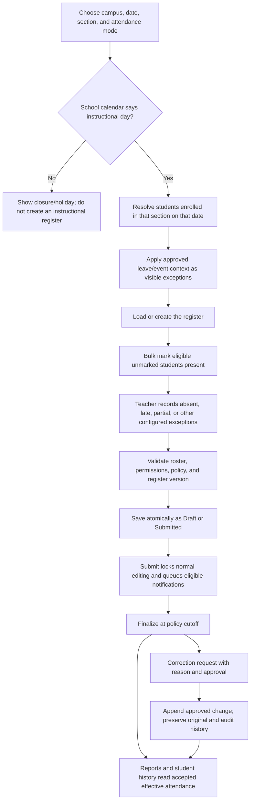

# Attendance Module Plan

**Package:** M14 — Attendance  
**Priority:** Core  
**Current status:** Partial; audit and workflow verification are still required.

This folder turns the supplied attendance proposal into an implementation roadmap grounded in the current ERP and published attendance/data standards. It covers student attendance first, then leave and corrections, staff attendance, reporting, and optional period/device capture.

## Plan documents

- [Student attendance and registers](01-student-attendance.md)
- [Leave, corrections, and notifications](02-leave-corrections-notifications.md)
- [Staff attendance](03-staff-attendance.md)
- [Reports, roles, and integrations](04-reports-and-integrations.md)
- [Current gaps and decisions](REMAINING.md)

## Goals and boundaries

- Give teachers a quick, class-scoped roll call with a bulk action and explicit exceptions.
- Keep a durable, attributable register for each attendance context; reports use the same accepted records.
- Respect dated student enrollment, school calendar, and configured attendance policy.
- Make corrections reviewable instead of silently replacing submitted/finalized data.
- Keep staff attendance separate from student attendance; connect it to HR and timetable only through agreed contracts.
- Start with daily student attendance. Period attendance and capture devices are optional follow-on capabilities.

**Not in the first release:** biometric, RFID, QR, GPS or facial capture; offline synchronization; counsellor case management; automated payroll calculation. Devices and offline sync require separate privacy, security, and operational decisions.

## Current implementation baseline

The current implementation is a basic daily student-attendance feature, not the complete menu implied by the module:

- `school_attendance` stores one row per tenant/student/date, with four accepted statuses in the API. It has no register, period, academic-year, lifecycle, correction, or staff-attendance entity.
- `GET /school/attendance`, `POST /school/attendance`, and `GET /school/attendance/summary` are the attendance API routes found in `server/src/routes/school.js`.
- The current mark screen is present in `src/components/SchoolPage.jsx`. It posts `entries`; `src/forms/frmSchoolAttendance/ListPage.jsx` posts a different `students` payload, so that form/API contract must be reconciled before relying on both surfaces.
- The save route upserts submitted rows, silently skips unknown/unsupported entries, and does not implement a submitted/finalized register or correction workflow.
- The GET route returns current active student class/section membership; historical enrollment validity is not applied. Counts are date-wide rather than constrained to the selected class/section.
- The menu advertises Register, Corrections, Staff Attendance, and Reports, but the reviewed API currently exposes only mark, summary, and profile/dashboard attendance data. Verify each route and screen before calling those submodules implemented.

These are audit findings, not a claim that no other code exists. See [remaining gaps](REMAINING.md) for the first verification and remediation work.

## Canonical attendance workflow

### Core rules

1. A register is scoped to tenant/campus, academic year, date, section, and optionally a timetable period/session. One eligible student can have at most one entry per register.
2. The roster is resolved using the enrollment that was valid on the register date. A student outside that enrollment is rejected by the server, not merely hidden by the UI.
3. Use daily mode as the first-release default. Design the register key to accommodate a period/session so period mode can be added without duplicating student-level attendance.
4. Attendance status describes what happened; authorization/reason (for example approved leave) is a separate attribute. Approved leave must not be reported as physically present. Holiday/closure is calendar context and is excluded from instructional denominators, not a student presence status.
5. Status labels and calculation policy are configurable by school/jurisdiction and effective date. Do not hardcode a country's legal attendance codes or a universal minimum percentage.
6. Draft saves may be revised under permission. Submitted/finalized entries are not silently overwritten; accepted corrections preserve old and new values, reason, actor, decision, and time.
7. Bulk save is one transaction. Duplicate, stale-version, or invalid-roster conflicts are returned explicitly; no partial success presented as a complete save.
8. Notifications are queued after a successful commit. Delivery failure must not roll back attendance; retries are idempotent and visible in a delivery log.

## Delivery order

| Phase | Deliverable | Exit criteria |
|---|---|---|
| 0. Contract and data audit | Reconcile existing UI/API contracts, permissions, tenant boundaries, migrations, enrollment history, and the calendar/timetable source of truth. | Approved attendance policy defaults and a safe migration/backfill plan; existing records reconcile. |
| 1. Daily student register | Dated roster, fast bulk marking, explicit status exceptions, draft/submitted lifecycle, duplicate protection, and student history. | Class register is accurate, atomic, tenant-scoped, and usable for a class-size performance test. |
| 2. Leave, correction, and alerts | Student leave requests, approval, immutable correction workflow, audit view, notification outbox. | Approved leave affects eligible future registers; past corrections require reason/approval; retries do not duplicate notices. |
| 3. Staff attendance | Manual staff check-in/out and admin marking, shift policy, staff leave integration, staff register. | Staff data is isolated from student records; late/missing punch handling and permissions are audited. |
| 4. Reports and integrations | Daily/monthly registers, student summaries, defaulters/trends, exports, dashboard and portal read views; validated HR/timetable links. | All totals reconcile to effective attendance and filtered exports; linked screens honor permissions. |
| 5. Optional expansion | Period attendance, device ingestion, offline sync, exam/event-specific workflows. | Separate scope, privacy/security review, migration and conflict-resolution tests before enabling. |

Build one phase at a time. Phase 0 must establish the local school policy and jurisdiction before legal codes, percentages, payroll rules, or notification channels are finalized.

## Research basis

- [Ed-Fi Data Standard v6 — Student Attendance Domain](https://docs.ed-fi.org/reference/data-exchange/data-standard/model-reference/student-attendance-domain/): describes a domain that represents both daily and class-period attendance. This supports a daily-first product with an explicit period context; it does not prescribe this school's policy.
- [UK Department for Education — Working together to improve school attendance](https://www.gov.uk/government/publications/working-together-to-improve-school-attendance): statutory guidance describing attendance responsibilities and what must be recorded in attendance/admission registers. It is a UK-specific example; applicable obligations and codes must be confirmed for the school's jurisdiction.
- [PostgreSQL constraints](https://www.postgresql.org/docs/current/ddl-constraints.html): database constraints are the final integrity boundary for uniqueness and valid row values; application checks alone are insufficient.
- [PostgreSQL concurrency control](https://www.postgresql.org/docs/current/mvcc.html): informs stale-write handling and concurrent register submission.

The vendor feature descriptions in the supplied proposal are treated as discovery notes, not independently verified evidence or a basis for a universal “better than other systems” claim. The product value here is the intended integration: one dated attendance source can serve the register, student history, notifications, dashboard, and approved downstream workflows.
