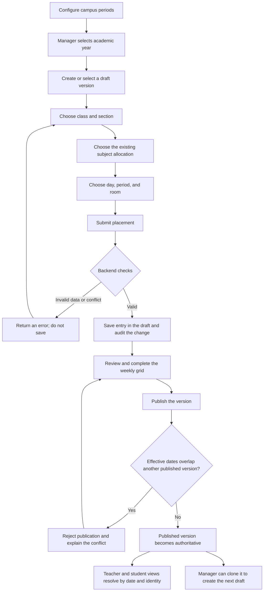
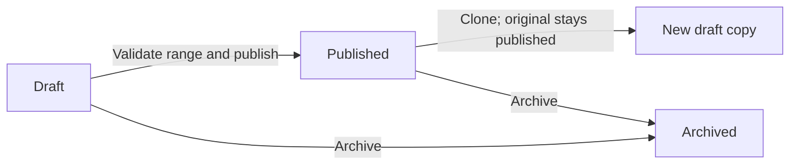
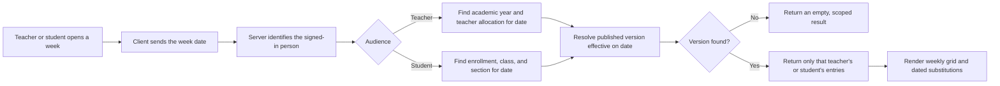
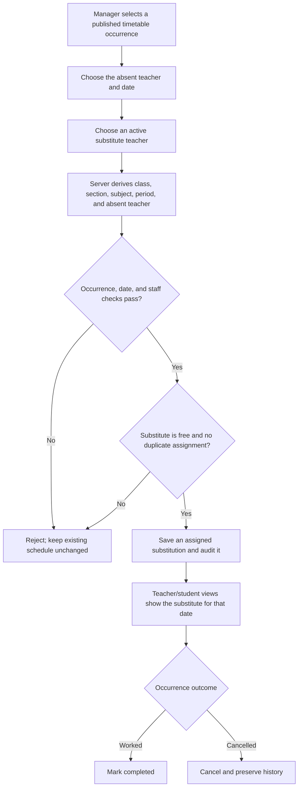

# Timetable Working Flow

This guide explains the current Timetable module from schedule setup through
teacher/student views and substitutions. The diagrams describe the application
flow, not an external-product comparison.

## At a glance

The scheduler builds a weekly schedule from records the ERP already knows:
academic years, classes, sections, subject allocations, teachers, rooms, and
campus periods. The backend validates each placement, saves it in a draft
version, and exposes the published version that applies to the requested date.

## Main scheduling flow

### What the backend checks before saving

The browser helps collect the values, but the server is the authority. It checks
that:

- The user has timetable-manage permission and all referenced records belong to
  the current school.
- The class and section are active, and the section belongs to the class.
- The selected active allocation belongs to that class/section and academic
  year. Subject and teacher are derived from that allocation instead of being
  independently re-entered.
- The period exists and matches the submitted period number; the room is active
  and has sufficient capacity for the class or section.
- The room, teacher, and class/section are not already booked during an
  overlapping time interval in the same version.

Timetable writes use a transaction-scoped lock so two simultaneous requests
cannot both pass the same conflict check and book the slot. The database also
has per-version slot constraints as a second guard.

## Version lifecycle

- **Draft:** managers can add, update, and remove entries. Draft schedules are
  normally hidden from teacher and student timetable views.
- **Published:** the version is used for dates in its effective range. Published
  entries are not edited in place; clone the version, edit the draft, and
  publish that revision.
- **Archived:** retained as history and excluded from normal selection.

The effective-date overlap check is serialized for concurrent publish requests
and backed by a database exclusion constraint. This prevents two published
versions for the same academic year from claiming the same effective dates.
Cloning creates a separate draft; it does not change the original version's
status or entries.

## Teacher and student viewing flow

The server derives teacher/student identity from the authenticated account; a
query parameter cannot select another person's timetable. Student history uses
the enrollment's class and section for the requested date. Managers can request
a specific version when reviewing schedules.

## Substitution flow

The substitution API verifies the date is on the timetable entry's weekday and
inside its academic year. It also checks the absent teacher matches the original
entry, the substitute is active, and there is no duplicate or conflicting
assignment. The original weekly timetable row remains unchanged; the substitution
is a separate dated record.

**Current implementation caveat:** substitution assignment requires the
timetable row's `is_published` flag. Publishing a version changes the version
status, but does not itself set that row flag. The Master screen does not expose
a separate per-entry publish action, so this workflow needs that publication
step available or wired before relying on substitutions end to end.

**Legacy-data caveat:** migration 29 backfills periods from campus templates,
but rows can remain without a `period_id` if no suitable period template exists.
The no-campus fallback should be verified against a disposable database before
relying on it for legacy records.

## Main features and why the flow is easier

| Feature | How it works | Practical benefit |
|---|---|---|
| Reuses ERP records | Select an existing allocation, class/section, room, and period. | Less duplicate typing and fewer mismatched teacher/subject assignments. |
| Server-side validation | Eligibility, capacity, and time conflicts are checked before saving. | Errors are caught at placement time rather than after a timetable is shared. |
| Draft and publish | Build privately, review, then publish an effective-dated version. | Staff and students do not depend on an unfinished working copy. |
| Clone instead of overwrite | Copy a published schedule into a new draft for revisions. | Past versions remain available for history and comparison. |
| Date-aware audience views | The signed-in teacher/student and requested date determine the result. | Users see their own schedule without searching or filtering a master spreadsheet. |
| Dated substitutions | A substitute is attached to one timetable occurrence, not substituted into the recurring weekly record. | The regular schedule and the exception remain distinct and auditable. |
| Conflict-safe writes | Transactions/locks and database constraints protect shared slots. | Concurrent schedulers are less likely to double-book a room, teacher, or class. |

Compared with a manually maintained spreadsheet or disconnected scheduling
tools, the main advantage is keeping scheduling in the same system as academic
years, allocations, rooms, and user identities. This is a workflow/design
advantage, not a benchmark claim that the module is better than every named
vendor system.

## Current scope versus planned work

**Available in the current flow:** manual timetable entry, version selection and
publication, date-based teacher/student views, conflict validation, and
substitution create/update/cancel workflows.

**Not represented as complete here:** automatic timetable generation, calendar
holidays and dated overrides, room-specific timetable view, calendar/print
exports, automatic notifications, and verified attendance/report integrations.
These remain later roadmap or QA items; see [Remaining Work](REMAINING.md).

## Main API surfaces

- `GET/POST/PUT/DELETE /school/periods` — period configuration.
- `GET/POST /school/timetable/versions`, `PUT /school/timetable/versions/:id`,
  and `POST /school/timetable/versions/:id/clone` — version lifecycle.
- `GET/POST /school/timetable`, `PUT/DELETE /school/timetable/:id` — schedule
  views and entry management.
- `GET/POST /school/substitutions`, `PUT/DELETE /school/substitutions/:id` —
  dated substitutions and their lifecycle.

The API is implemented in `server/src/routes/school_more.js`; the four current
screens are dispatched from `src/components/SchoolPage.jsx`.
